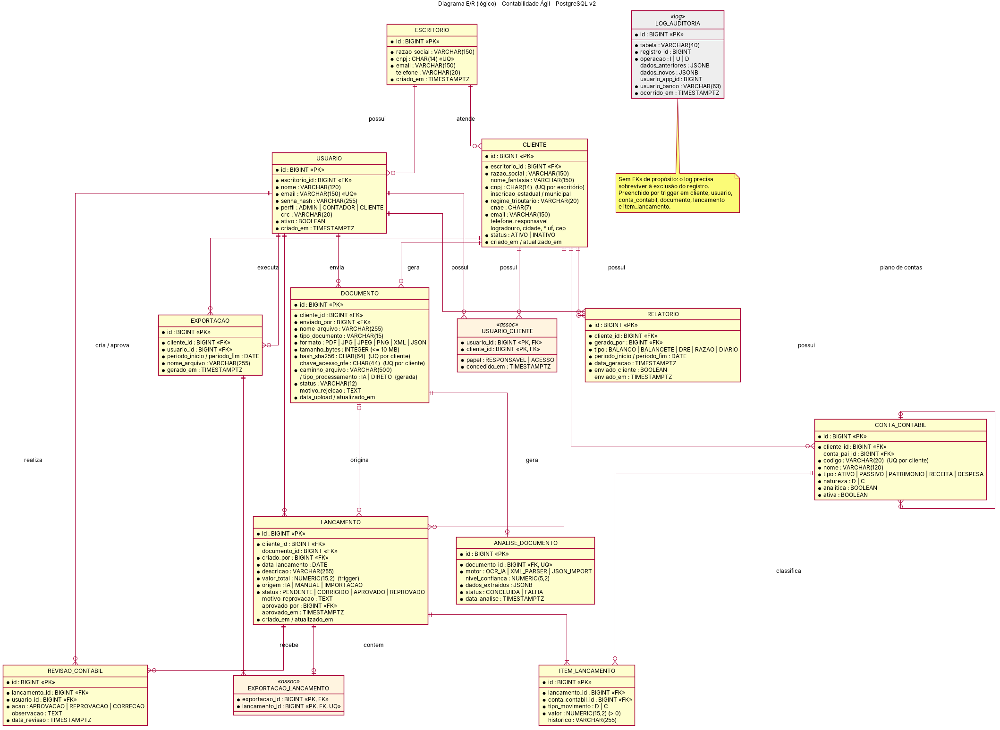

# Projeto de Banco de Dados — Contabilidade Ágil

**Disciplina:** Laboratório de Banco de Dados — Fatec Sorocaba
**SGBD:** PostgreSQL 16 (mínimo 14)
**Scripts:** pasta `db/` do **repositório da aplicação** — `01_ddl_estrutura.sql` → `02_dml_carga_inicial.sql` → `03_programacao_avancada.sql` → `04_testes_e_transacoes.sql`. A aplicação (API Node.js) usa esses mesmos scripts para criar o banco em produção.

---

## 1. Contextualização

### 1.1 Problema de negócio
Escritórios de contabilidade recebem diariamente notas fiscais, comprovantes e extratos dos clientes por e-mail e WhatsApp, e o contador digita cada lançamento contábil à mão. O processo é lento, sujeito a erro de digitação e de classificação, e não deixa rastro de quem fez o quê.

### 1.2 Escopo da aplicação
O **Contabilidade Ágil** centraliza o envio de documentos, extrai os dados por OCR/IA (ou diretamente, no caso de XML/JSON), sugere o lançamento contábil em partidas dobradas e coloca a sugestão numa fila para o contador aprovar, corrigir ou reprovar. Depois de aprovados, os lançamentos alimentam relatórios (balancete, razão, DRE) e podem ser exportados em CSV para o sistema contábil do escritório.

### 1.3 Público-alvo
| Perfil | O que faz no sistema |
|---|---|
| **Administrador** | Cadastra contadores e gerencia acessos do escritório. |
| **Contador** | Gerencia a carteira de empresas, o plano de contas de cada uma, revisa sugestões da IA e gera relatórios. |
| **Cliente** (usuário da empresa) | Envia documentos e acompanha status e relatórios liberados. |

### 1.4 Regras de negócio que impactam diretamente os dados
| Regra | Como o banco garante |
|---|---|
| **RN01** — nenhum lançamento é finalizado sem aprovação do contador | `status` com CHECK; `ck_lancamento_aprov` exige `aprovado_por`/`aprovado_em`; `sp_aprovar_lancamento` verifica se o usuário é contador responsável; trigger impede alterar lançamento APROVADO/REPROVADO |
| **Partidas dobradas** — Σ débitos = Σ créditos | `CONSTRAINT TRIGGER ... DEFERRABLE INITIALLY DEFERRED` checada no COMMIT |
| **RN02/RN07** — documentos (inclusive rejeitados) ficam armazenados | `ON DELETE RESTRICT` de documento; rejeição é mudança de status, nunca DELETE |
| **RN03/RF25** — correções do contador são registradas | Tabela `revisao_contabil` + `log_auditoria` com valores anteriores e posteriores |
| **RN04** — XML/JSON não passam pela IA | Coluna gerada `documento.tipo_processamento` |
| **RN06** — todo documento pertence a um cliente | `cliente_id NOT NULL` + FK |
| **RF07** — plano de contas individual por empresa | `conta_contabil.cliente_id` + `UNIQUE (cliente_id, codigo)` + trigger que impede usar conta de outra empresa |
| **RF10** — sem documentos duplicados | `UNIQUE (cliente_id, hash_sha256)` e `UNIQUE (cliente_id, chave_acesso_nfe)` |
| **RF24** — rejeição exige justificativa | CHECK em `documento` + validação em `sp_reprovar_documento` |
| **RF27** — lançamento não pode ser exportado duas vezes | `UNIQUE (lancamento_id)` em `exportacao_lancamento` |
| **RF28** — trilha de auditoria com antes/depois | Trigger genérico `fn_tg_auditoria` gravando JSONB |

---

## 2. Evolução do modelo em relação ao DER anterior

O DER do repositório (`docs/diagramas/diagrama-er.puml`) foi o ponto de partida. As mudanças abaixo vieram do confronto dele com os requisitos, com as telas do protótipo e com as exigências do edital da disciplina.

| # | Situação no DER anterior | Mudança | Motivo |
|---|---|---|---|
| 1 | Não havia relacionamento **N:M** | Criadas `usuario_cliente` e `exportacao_lancamento` | O protótipo já trata o usuário com uma *lista* de empresas; um contador atende várias empresas e uma empresa pode ter mais de um contador. O edital exige N:M resolvido |
| 2 | `CONTA_CONTABIL` sem vínculo com empresa | `cliente_id` + `conta_pai_id` (hierarquia) + `natureza` + `analitica` + `ativa` | RF07 (plano individual) e tela de plano de contas em árvore; natureza é necessária para calcular saldo |
| 3 | `CLIENTE` só com nome/CNPJ/e-mail | Inscrições, regime tributário, CNAE, endereço, responsável | RF04 e os campos que a tela "Nova Empresa" já coleta |
| 4 | `LANCAMENTO` com `documento_id` **e** `analise_id` | Mantido só `documento_id` | `analise` é 1:1 com `documento`; guardar os dois cria dependência transitiva (viola 3FN) e permite apontar para análise de outro documento |
| 5 | `HISTORICO_ALTERACAO` com FKs opcionais para documento e lançamento | Substituída por `log_auditoria` genérica, sem FK, com `dados_anteriores`/`dados_novos` em JSONB | RF28 pede valores antes/depois; o log precisa sobreviver à exclusão do registro e cobrir qualquer tabela |
| 6 | `RELATORIO` aparecia só na imagem `.jpeg`, ligado a lançamento | Tabela `relatorio` ligada a cliente, com `enviado_cliente` | O relatório é de uma empresa num período (não de um lançamento); a flag de liberação existe no protótipo |
| 7 | Sem campos para detectar duplicidade | `hash_sha256`, `chave_acesso_nfe`, `tamanho_bytes` | RF09, RF10 |
| 8 | Sem controle de exportação | `exportacao` + `exportacao_lancamento` | RF26, RF27 |
| 9 | Status com valores diferentes entre requisitos e protótipo | Domínios fechados por CHECK, incluindo `FALHA` (RF18) e `CORRIGIDO` | Um único vocabulário para API, front e banco |
| 10 | PKs `UUID` | `BIGINT GENERATED ALWAYS AS IDENTITY` | Índices menores e mais rápidos em JOINs, scripts de teste legíveis ("lançamento 7"). Se a API exigir IDs não sequenciais na URL, dá para adicionar uma coluna `uuid` pública com `gen_random_uuid()` sem trocar a PK |



*Fonte do diagrama: [`docs/diagramas/diagrama-er.puml`](../diagramas/diagrama-er.puml) (o workflow do repositório gera o PNG automaticamente).*

---

## 3. Modelagem lógica

### 3.1 Visão geral
14 tabelas no schema `contabil`:

| Grupo | Tabelas |
|---|---|
| Acesso | `escritorio`, `usuario`, `cliente`, `usuario_cliente` (N:M) |
| Plano de contas | `conta_contabil` (autorrelacionamento) |
| Entrada de documentos | `documento`, `analise_documento` (1:1) |
| Escrituração | `lancamento`, `item_lancamento` (1:N), `revisao_contabil` |
| Saída | `relatorio`, `exportacao`, `exportacao_lancamento` (N:M) |
| Auditoria | `log_auditoria` |

**Políticas de integridade referencial (ON DELETE)**

| Política | Onde | Por quê |
|---|---|---|
| `RESTRICT` | documento, lançamento, conta usada em item, usuário que criou/aprovou | Dado contábil e fiscal não pode desaparecer por efeito colateral (RN02, RN07). Para "remover", usa-se `status`/`ativo` |
| `CASCADE` | `item_lancamento` → `lancamento`; `analise_documento` → `documento`; `usuario_cliente`; `conta_contabil` → `cliente` | O filho não tem sentido sem o pai. Na prática o CASCADE só age em lançamento PENDENTE, porque o trigger bloqueia excluir lançamento aprovado |
| `ON UPDATE CASCADE` | todas as FKs | PKs são IDENTITY e não mudam; a cláusula fica por segurança |

### 3.2 Dicionário de dados
Gerado a partir do catálogo do PostgreSQL (`COMMENT ON COLUMN` no script 01), então o documento e o banco não divergem.

#### 3.2.1 `escritorio`

Escritório de contabilidade que usa o sistema (tenant).

| Coluna | Tipo | Nulo? | Default | Restrições | Descrição |
|---|---|---|---|---|---|
| `id` | bigint | não | IDENTITY | PK | Identificador do escritório. |
| `razao_social` | varchar(150) | não |  |  | Razão social do escritório de contabilidade. |
| `cnpj` | char(14) | não |  | UNIQUE, CHECK | CNPJ, só dígitos (14). DV validado por fn_validar_cnpj. |
| `email` | varchar(150) | não |  | CHECK | E-mail institucional. |
| `telefone` | varchar(20) | sim |  |  | Telefone de contato. |
| `criado_em` | timestamptz | não | now() |  | Data/hora de cadastro. |

<details><summary>CHECKs de <code>escritorio</code></summary>

- `ck_escritorio_cnpj`: `CHECK ((cnpj ~ '^[0-9]{14}$'))`
- `ck_escritorio_cnpj_dv`: `CHECK (fn_validar_cnpj((cnpj)))`
- `ck_escritorio_email`: `CHECK (((email) ~* '^[^@\s]+@[^@\s]+\.[^@\s]+$'))`

</details>

#### 3.2.2 `usuario`

Usuários do sistema: ADMIN, CONTADOR ou CLIENTE (RF01, RF03).

| Coluna | Tipo | Nulo? | Default | Restrições | Descrição |
|---|---|---|---|---|---|
| `id` | bigint | não | IDENTITY | PK | Identificador do usuário. |
| `escritorio_id` | bigint | não |  | FK→escritorio (DEL RESTRICT) | Escritório ao qual o usuário pertence. |
| `nome` | varchar(120) | não |  |  | Nome completo. |
| `email` | varchar(150) | não |  | UNIQUE, CHECK | Login do usuário; único no sistema (RF01). |
| `senha_hash` | varchar(255) | não |  |  | Hash da senha (bcrypt gerado pela aplicação). Nunca a senha em texto. |
| `perfil` | varchar(10) | não |  | CHECK | ADMIN, CONTADOR ou CLIENTE (RNF03). |
| `crc` | varchar(20) | sim |  | CHECK | Registro no Conselho Regional de Contabilidade; obrigatório para CONTADOR. |
| `ativo` | boolean | não | true |  | FALSE desativa o acesso sem apagar o histórico (RF03, RF06). |
| `criado_em` | timestamptz | não | now() |  | Data/hora de cadastro. |

<details><summary>CHECKs de <code>usuario</code></summary>

- `ck_usuario_crc`: `CHECK ((((perfil) <> 'CONTADOR') OR (crc IS NOT NULL)))`
- `ck_usuario_email`: `CHECK (((email) ~* '^[^@\s]+@[^@\s]+\.[^@\s]+$'))`
- `ck_usuario_perfil`: `CHECK (((perfil) = ANY ((ARRAY['ADMIN', 'CONTADOR', 'CLIENTE'])[])))`

</details>

#### 3.2.3 `cliente`

Empresas clientes atendidas pelo escritório (RF04, RF06).

| Coluna | Tipo | Nulo? | Default | Restrições | Descrição |
|---|---|---|---|---|---|
| `id` | bigint | não | IDENTITY | PK | Identificador da empresa cliente. |
| `escritorio_id` | bigint | não |  | UNIQUE, FK→escritorio (DEL RESTRICT) | Escritório que atende a empresa. |
| `razao_social` | varchar(150) | não |  |  | Razão social. |
| `nome_fantasia` | varchar(150) | sim |  |  | Nome fantasia. |
| `cnpj` | char(14) | não |  | UNIQUE, CHECK | CNPJ, só dígitos (14). Único por escritório; DV validado. |
| `inscricao_estadual` | varchar(20) | sim |  |  | Inscrição estadual (NULL = isento). |
| `inscricao_municipal` | varchar(20) | sim |  |  | Inscrição municipal. |
| `regime_tributario` | varchar(20) | não | 'SIMPLES_NACIONAL' | CHECK | SIMPLES_NACIONAL, LUCRO_PRESUMIDO, LUCRO_REAL ou MEI (RF04). |
| `cnae` | char(7) | sim |  | CHECK | CNAE principal, 7 dígitos. |
| `email` | varchar(150) | não |  | CHECK | E-mail para notificações (RF31). |
| `telefone` | varchar(20) | sim |  |  | Telefone de contato. |
| `responsavel` | varchar(120) | sim |  |  | Pessoa de contato na empresa. |
| `logradouro` | varchar(150) | sim |  |  | Endereço (rua e número). |
| `cidade` | varchar(80) | sim |  |  | Município. |
| `uf` | char(2) | não | 'SP' | CHECK | Sigla da UF. |
| `cep` | char(8) | sim |  | CHECK | CEP, só dígitos (8). |
| `status` | varchar(10) | não | 'ATIVO' | CHECK | ATIVO ou INATIVO (RF06). Inativo não recebe lançamentos. |
| `criado_em` | timestamptz | não | now() |  | Data/hora de cadastro. |
| `atualizado_em` | timestamptz | não | now() |  | Última alteração (mantida por trigger). |

<details><summary>CHECKs de <code>cliente</code></summary>

- `ck_cliente_cep`: `CHECK (((cep IS NULL) OR (cep ~ '^[0-9]{8}$')))`
- `ck_cliente_cnae`: `CHECK (((cnae IS NULL) OR (cnae ~ '^[0-9]{7}$')))`
- `ck_cliente_cnpj`: `CHECK ((cnpj ~ '^[0-9]{14}$'))`
- `ck_cliente_cnpj_dv`: `CHECK (fn_validar_cnpj((cnpj)))`
- `ck_cliente_email`: `CHECK (((email) ~* '^[^@\s]+@[^@\s]+\.[^@\s]+$'))`
- `ck_cliente_regime`: `CHECK (((regime_tributario) = ANY ((ARRAY['SIMPLES_NACIONAL', 'LUCRO_PRESUMIDO', 'LUCRO_REAL', 'MEI'])[])))`
- `ck_cliente_status`: `CHECK (((status) = ANY ((ARRAY['ATIVO', 'INATIVO'])[])))`
- `ck_cliente_uf`: `CHECK ((uf = ANY (ARRAY['AC', 'AL', 'AP', 'AM', 'BA', 'CE', 'DF', 'ES', 'GO', 'MA', 'MT', 'MS', 'MG', 'PA', 'PB', 'PR', 'PE', 'PI', 'RJ', 'RN', 'RS', 'RO', 'RR', 'SC', 'SP', 'SE', 'TO'])))`

</details>

#### 3.2.4 `usuario_cliente`

N:M usuário × empresa: carteira do contador e acesso do usuário-cliente (RF05, RF12).

| Coluna | Tipo | Nulo? | Default | Restrições | Descrição |
|---|---|---|---|---|---|
| `usuario_id` | bigint | não |  | PK, FK→usuario (DEL CASCADE) | Usuário (contador ou usuário-cliente). |
| `cliente_id` | bigint | não |  | PK, FK→cliente (DEL CASCADE) | Empresa à qual o usuário está vinculado. |
| `papel` | varchar(12) | não |  | CHECK | RESPONSAVEL (contador da carteira) ou ACESSO (usuário da empresa). |
| `concedido_em` | timestamptz | não | now() |  | Data/hora em que o vínculo foi criado. |

<details><summary>CHECKs de <code>usuario_cliente</code></summary>

- `ck_uc_papel`: `CHECK (((papel) = ANY ((ARRAY['RESPONSAVEL', 'ACESSO'])[])))`

</details>

#### 3.2.5 `conta_contabil`

Plano de contas hierárquico e individualizado por empresa (RF07).

| Coluna | Tipo | Nulo? | Default | Restrições | Descrição |
|---|---|---|---|---|---|
| `id` | bigint | não | IDENTITY | PK, CHECK | Identificador da conta. |
| `cliente_id` | bigint | não |  | UNIQUE, FK→cliente (DEL CASCADE) | Empresa dona deste plano de contas (RF07). |
| `conta_pai_id` | bigint | sim |  | FK→conta_contabil (DEL RESTRICT), CHECK | Conta sintética imediatamente superior (NULL = grupo raiz). |
| `codigo` | varchar(20) | não |  | UNIQUE, CHECK | Código estruturado, ex.: 1.1.01.001. Único por empresa. |
| `nome` | varchar(120) | não |  |  | Nome da conta. |
| `tipo` | varchar(10) | não |  | CHECK | ATIVO, PASSIVO, PATRIMONIO, RECEITA ou DESPESA. |
| `natureza` | char(1) | não |  | CHECK | D (devedora) ou C (credora): define o sinal do saldo. |
| `analitica` | boolean | não | false |  | TRUE = recebe lançamentos; FALSE = conta sintética (agrupadora). |
| `ativa` | boolean | não | true |  | FALSE impede novos lançamentos na conta. |

<details><summary>CHECKs de <code>conta_contabil</code></summary>

- `ck_conta_codigo`: `CHECK (((codigo) ~ '^[0-9]+(\.[0-9]+)*$'))`
- `ck_conta_natureza`: `CHECK ((natureza = ANY (ARRAY['D', 'C'])))`
- `ck_conta_pai`: `CHECK (((conta_pai_id IS NULL) OR (conta_pai_id <> id)))`
- `ck_conta_tipo`: `CHECK (((tipo) = ANY ((ARRAY['ATIVO', 'PASSIVO', 'PATRIMONIO', 'RECEITA', 'DESPESA'])[])))`

</details>

#### 3.2.6 `documento`

Arquivos fiscais enviados para processamento (RF08–RF11, RN02, RN06, RN07).

| Coluna | Tipo | Nulo? | Default | Restrições | Descrição |
|---|---|---|---|---|---|
| `id` | bigint | não | IDENTITY | PK | Identificador do documento. |
| `cliente_id` | bigint | não |  | UNIQUE, FK→cliente (DEL RESTRICT) | Empresa dona do documento (RN06). |
| `enviado_por` | bigint | não |  | FK→usuario (DEL RESTRICT) | Usuário que fez o upload (cliente ou contador — RF12). |
| `nome_arquivo` | varchar(255) | não |  |  | Nome original do arquivo. |
| `tipo_documento` | varchar(15) | não |  | CHECK | NOTA_FISCAL, COMPROVANTE, EXTRATO, XML_NFE, JSON_CONTABIL, CONTRATO ou OUTRO (RF16). |
| `formato` | varchar(4) | não |  | CHECK | Extensão: PDF, JPG, JPEG, PNG, XML ou JSON (RF09, RNF10). |
| `tamanho_bytes` | integer | não |  | CHECK | Tamanho do arquivo; máximo 10 MB (RF09). |
| `hash_sha256` | char(64) | não |  | UNIQUE, CHECK | Hash do conteúdo do arquivo, usado para barrar duplicatas (RF10). |
| `chave_acesso_nfe` | char(44) | sim |  | UNIQUE, CHECK | Chave de 44 dígitos da NF-e, quando houver (RF10). |
| `caminho_arquivo` | varchar(500) | não |  |  | Local do arquivo no storage (o binário não fica no banco). |
| `tipo_processamento` | varchar(6) | sim | GERADA |  | Coluna gerada: DIRETO para XML/JSON, IA para os demais (RN04). |
| `status` | varchar(12) | não | 'PENDENTE' | CHECK | PENDENTE, PROCESSANDO, ANALISADO, IMPORTADO, APROVADO, REJEITADO ou FALHA (RF11, RF18). |
| `motivo_rejeicao` | text | sim |  | CHECK | Justificativa obrigatória quando REJEITADO (RF24). |
| `data_upload` | timestamptz | não | now() |  | Data/hora do envio. |
| `atualizado_em` | timestamptz | não | now() |  | Última alteração (mantida por trigger). |

<details><summary>CHECKs de <code>documento</code></summary>

- `ck_documento_chave`: `CHECK (((chave_acesso_nfe IS NULL) OR (chave_acesso_nfe ~ '^[0-9]{44}$')))`
- `ck_documento_formato`: `CHECK (((formato) = ANY ((ARRAY['PDF', 'JPG', 'JPEG', 'PNG', 'XML', 'JSON'])[])))`
- `ck_documento_hash`: `CHECK ((hash_sha256 ~ '^[0-9a-f]{64}$'))`
- `ck_documento_rejeicao`: `CHECK ((((status) <> 'REJEITADO') OR ((motivo_rejeicao IS NOT NULL) AND (length(TRIM(BOTH FROM motivo_rejeicao)) >= 10))))`
- `ck_documento_status`: `CHECK (((status) = ANY ((ARRAY['PENDENTE', 'PROCESSANDO', 'ANALISADO', 'IMPORTADO', 'APROVADO', 'REJEITADO', 'FALHA'])[])))`
- `ck_documento_tamanho`: `CHECK (((tamanho_bytes > 0) AND (tamanho_bytes <= 10485760)))`
- `ck_documento_tipo`: `CHECK (((tipo_documento) = ANY ((ARRAY['NOTA_FISCAL', 'COMPROVANTE', 'EXTRATO', 'XML_NFE', 'JSON_CONTABIL', 'CONTRATO', 'OUTRO'])[])))`
- `ck_documento_tipo_formato`: `CHECK (((((tipo_documento) = 'XML_NFE') AND ((formato) = 'XML')) OR (((tipo_documento) = 'JSON_CONTABIL') AND ((formato) = 'JSON')) OR (((tipo_documento) = ANY ((ARRAY['NOTA_FISCAL', 'COMPROVANTE', 'EXTRATO', 'CONTRATO'])[])) AND ((formato) = ANY ((ARRAY['PDF', 'JPG', 'JPEG', 'PNG'])[]))) OR ((tipo_documento) = 'OUTRO')))`

</details>

#### 3.2.7 `analise_documento`

Resultado da leitura OCR/IA ou do parser XML/JSON (RF13–RF17).

| Coluna | Tipo | Nulo? | Default | Restrições | Descrição |
|---|---|---|---|---|---|
| `id` | bigint | não | IDENTITY | PK | Identificador da análise. |
| `documento_id` | bigint | não |  | UNIQUE, FK→documento (DEL CASCADE) | Documento analisado (relação 1:1). |
| `motor` | varchar(12) | não |  | CHECK | OCR_IA, XML_PARSER ou JSON_IMPORT. |
| `nivel_confianca` | numeric(5,2) | sim |  | CHECK | Confiança da IA de 0 a 100 (RF17). NULL para parser determinístico. |
| `dados_extraidos` | jsonb | não | '{}' |  | Campos extraídos (emitente, valor, data...). JSONB porque variam por tipo de documento. |
| `status` | varchar(10) | não |  | CHECK | CONCLUIDA ou FALHA (RF18). |
| `data_analise` | timestamptz | não | now() |  | Data/hora da análise. |

<details><summary>CHECKs de <code>analise_documento</code></summary>

- `ck_analise_conf`: `CHECK (((nivel_confianca IS NULL) OR ((nivel_confianca >= (0)::numeric) AND (nivel_confianca <= (100)::numeric))))`
- `ck_analise_conf_ia`: `CHECK ((((motor) <> 'OCR_IA') OR ((status) = 'FALHA') OR (nivel_confianca IS NOT NULL)))`
- `ck_analise_motor`: `CHECK (((motor) = ANY ((ARRAY['OCR_IA', 'XML_PARSER', 'JSON_IMPORT'])[])))`
- `ck_analise_status`: `CHECK (((status) = ANY ((ARRAY['CONCLUIDA', 'FALHA'])[])))`

</details>

#### 3.2.8 `lancamento`

Cabeçalho do lançamento contábil (RF15, RF22, RF23, RN01).

| Coluna | Tipo | Nulo? | Default | Restrições | Descrição |
|---|---|---|---|---|---|
| `id` | bigint | não | IDENTITY | PK | Identificador do lançamento. |
| `cliente_id` | bigint | não |  | FK→cliente (DEL RESTRICT) | Empresa do lançamento. Precisa coincidir com a do documento (trigger). |
| `documento_id` | bigint | sim |  | FK→documento (DEL RESTRICT), CHECK | Documento de origem; NULL em lançamento manual. |
| `criado_por` | bigint | não |  | FK→usuario (DEL RESTRICT) | Usuário (ou serviço de IA) que criou o lançamento. |
| `data_lancamento` | date | não |  |  | Data contábil (competência) do fato. |
| `descricao` | varchar(255) | não |  |  | Histórico do lançamento. |
| `valor_total` | numeric(15,2) | não | 0 | CHECK | Soma dos débitos dos itens. Desnormalizada e mantida por trigger. |
| `origem` | varchar(10) | não |  | CHECK | IA, MANUAL ou IMPORTACAO (XML/JSON — RN04). |
| `status` | varchar(10) | não | 'PENDENTE' | CHECK | PENDENTE, CORRIGIDO, APROVADO ou REPROVADO. APROVADO e REPROVADO são finais (RN01). |
| `motivo_reprovacao` | text | sim |  | CHECK | Motivo obrigatório quando REPROVADO. |
| `aprovado_por` | bigint | sim |  | FK→usuario (DEL RESTRICT), CHECK | Contador que aprovou (RN01). |
| `aprovado_em` | timestamptz | sim |  | CHECK | Data/hora da aprovação; base do tempo médio de revisão (RF30). |
| `criado_em` | timestamptz | não | now() |  | Data/hora de criação. |
| `atualizado_em` | timestamptz | não | now() |  | Última alteração (mantida por trigger). |

<details><summary>CHECKs de <code>lancamento</code></summary>

- `ck_lancamento_aprov`: `CHECK ((((status) <> 'APROVADO') OR ((aprovado_por IS NOT NULL) AND (aprovado_em IS NOT NULL))))`
- `ck_lancamento_doc`: `CHECK ((((origem) = 'MANUAL') OR (documento_id IS NOT NULL)))`
- `ck_lancamento_origem`: `CHECK (((origem) = ANY ((ARRAY['IA', 'MANUAL', 'IMPORTACAO'])[])))`
- `ck_lancamento_reprov`: `CHECK ((((status) <> 'REPROVADO') OR (motivo_reprovacao IS NOT NULL)))`
- `ck_lancamento_status`: `CHECK (((status) = ANY ((ARRAY['PENDENTE', 'CORRIGIDO', 'APROVADO', 'REPROVADO'])[])))`
- `ck_lancamento_valor`: `CHECK ((valor_total >= (0)::numeric))`

</details>

#### 3.2.9 `item_lancamento`

Partidas de débito e crédito de cada lançamento (partidas dobradas).

| Coluna | Tipo | Nulo? | Default | Restrições | Descrição |
|---|---|---|---|---|---|
| `id` | bigint | não | IDENTITY | PK | Identificador da partida. |
| `lancamento_id` | bigint | não |  | FK→lancamento (DEL CASCADE) | Lançamento ao qual a partida pertence. |
| `conta_contabil_id` | bigint | não |  | FK→conta_contabil (DEL RESTRICT) | Conta analítica, ativa, do plano da mesma empresa (trigger). |
| `tipo_movimento` | char(1) | não |  | CHECK | D (débito) ou C (crédito). |
| `valor` | numeric(15,2) | não |  | CHECK | Valor da partida, sempre positivo. |
| `historico` | varchar(255) | sim |  |  | Complemento do histórico desta partida. |

<details><summary>CHECKs de <code>item_lancamento</code></summary>

- `ck_item_tipo`: `CHECK ((tipo_movimento = ANY (ARRAY['D', 'C'])))`
- `ck_item_valor`: `CHECK ((valor > (0)::numeric))`

</details>

#### 3.2.10 `revisao_contabil`

Aprovações, reprovações e correções feitas pelo contador (RF25, RN03).

| Coluna | Tipo | Nulo? | Default | Restrições | Descrição |
|---|---|---|---|---|---|
| `id` | bigint | não | IDENTITY | PK | Identificador da revisão. |
| `lancamento_id` | bigint | não |  | FK→lancamento (DEL CASCADE) | Lançamento revisado. |
| `usuario_id` | bigint | não |  | FK→usuario (DEL RESTRICT) | Contador que revisou. |
| `acao` | varchar(10) | não |  | CHECK | APROVACAO, REPROVACAO ou CORRECAO (RF25). |
| `observacao` | text | sim |  | CHECK | Justificativa; obrigatória para REPROVACAO e CORRECAO. |
| `data_revisao` | timestamptz | não | now() |  | Data/hora da revisão. |

<details><summary>CHECKs de <code>revisao_contabil</code></summary>

- `ck_revisao_acao`: `CHECK (((acao) = ANY ((ARRAY['APROVACAO', 'REPROVACAO', 'CORRECAO'])[])))`
- `ck_revisao_obs`: `CHECK ((((acao) = 'APROVACAO') OR (observacao IS NOT NULL)))`

</details>

#### 3.2.11 `relatorio`

Relatórios contábeis gerados e liberados ao cliente.

| Coluna | Tipo | Nulo? | Default | Restrições | Descrição |
|---|---|---|---|---|---|
| `id` | bigint | não | IDENTITY | PK | Identificador do relatório. |
| `cliente_id` | bigint | não |  | FK→cliente (DEL CASCADE) | Empresa do relatório. |
| `gerado_por` | bigint | não |  | FK→usuario (DEL RESTRICT) | Contador que gerou. |
| `tipo` | varchar(10) | não |  | CHECK | BALANCO, BALANCETE, DRE, RAZAO ou DIARIO. |
| `periodo_inicio` | date | não |  | CHECK | Início do período apurado. |
| `periodo_fim` | date | não |  | CHECK | Fim do período apurado (>= início). |
| `data_geracao` | timestamptz | não | now() |  | Data/hora da geração. |
| `enviado_cliente` | boolean | não | false | CHECK | TRUE = liberado para o cliente ver. |
| `enviado_em` | timestamptz | sim |  | CHECK | Data/hora da liberação; preenchida se e somente se enviado_cliente. |

<details><summary>CHECKs de <code>relatorio</code></summary>

- `ck_relatorio_envio`: `CHECK ((enviado_cliente = (enviado_em IS NOT NULL)))`
- `ck_relatorio_periodo`: `CHECK ((periodo_fim >= periodo_inicio))`
- `ck_relatorio_tipo`: `CHECK (((tipo) = ANY ((ARRAY['BALANCO', 'BALANCETE', 'DRE', 'RAZAO', 'DIARIO'])[])))`

</details>

#### 3.2.12 `exportacao`

Lotes de exportação CSV de lançamentos aprovados (RF26).

| Coluna | Tipo | Nulo? | Default | Restrições | Descrição |
|---|---|---|---|---|---|
| `id` | bigint | não | IDENTITY | PK | Identificador do lote de exportação. |
| `cliente_id` | bigint | não |  | FK→cliente (DEL RESTRICT) | Empresa exportada. |
| `usuario_id` | bigint | não |  | FK→usuario (DEL RESTRICT) | Contador que exportou. |
| `periodo_inicio` | date | não |  | CHECK | Início do período exportado. |
| `periodo_fim` | date | não |  | CHECK | Fim do período exportado. |
| `nome_arquivo` | varchar(255) | não |  |  | Nome do CSV gerado. |
| `gerado_em` | timestamptz | não | now() |  | Data/hora da exportação. |

<details><summary>CHECKs de <code>exportacao</code></summary>

- `ck_exportacao_periodo`: `CHECK ((periodo_fim >= periodo_inicio))`

</details>

#### 3.2.13 `exportacao_lancamento`

N:M exportação × lançamento; impede reexportação (RF27).

| Coluna | Tipo | Nulo? | Default | Restrições | Descrição |
|---|---|---|---|---|---|
| `exportacao_id` | bigint | não |  | PK, FK→exportacao (DEL CASCADE) | Lote de exportação. |
| `lancamento_id` | bigint | não |  | UNIQUE, PK, FK→lancamento (DEL RESTRICT) | Lançamento exportado; UNIQUE impede reexportação (RF27). |

#### 3.2.14 `log_auditoria`

Trilha de auditoria com valores anteriores e posteriores (RF28, RF29).

| Coluna | Tipo | Nulo? | Default | Restrições | Descrição |
|---|---|---|---|---|---|
| `id` | bigint | não | IDENTITY | PK | Identificador do registro de log. |
| `tabela` | varchar(40) | não |  |  | Tabela alterada. |
| `registro_id` | bigint | não |  |  | id da linha alterada. |
| `operacao` | char(1) | não |  | CHECK | I (insert), U (update) ou D (delete). |
| `dados_anteriores` | jsonb | sim |  | CHECK | Linha antes da alteração (JSONB). Credenciais mascaradas. |
| `dados_novos` | jsonb | sim |  | CHECK | Linha depois da alteração (JSONB). Credenciais mascaradas. |
| `usuario_app_id` | bigint | sim |  |  | Lido de current_setting('app.usuario_id'), definido pela aplicação a cada transação. |
| `usuario_banco` | varchar(63) | não | CURRENT_USER |  | Usuário do PostgreSQL que executou o comando. |
| `ocorrido_em` | timestamptz | não | clock_timestamp() |  | Momento exato (clock_timestamp). |

<details><summary>CHECKs de <code>log_auditoria</code></summary>

- `ck_log_dados`: `CHECK ((((operacao = 'I') AND (dados_anteriores IS NULL) AND (dados_novos IS NOT NULL)) OR ((operacao = 'U') AND (dados_anteriores IS NOT NULL) AND (dados_novos IS NOT NULL)) OR ((operacao = 'D') AND (dados_anteriores IS NOT NULL) AND (dados_novos IS NULL))))`
- `ck_log_operacao`: `CHECK ((operacao = ANY (ARRAY['I', 'U', 'D'])))`

</details>

---

## 4. Normalização

### 4.1 1ª Forma Normal — valores atômicos, sem grupos repetidos
- As partidas do lançamento ficam em `item_lancamento` (uma linha por partida), não em colunas `debito1, credito1, debito2…` nem numa lista dentro do lançamento.
- O protótipo guarda **débito e crédito em duas colunas** em cada item; no banco virou `tipo_movimento` (D/C) + `valor` > 0. Assim não existe a linha inválida "débito 100 e crédito 50 ao mesmo tempo", que a tela precisava validar à mão.
- A carteira de empresas do usuário (lista no protótipo) virou a tabela `usuario_cliente`.
- Endereço foi mantido em colunas simples (logradouro, cidade, UF, CEP), suficiente para o escopo.

### 4.2 2ª Forma Normal — sem dependência parcial da chave
- As únicas PKs compostas estão nas associativas. Em `usuario_cliente (usuario_id, cliente_id)`, `papel` e `concedido_em` dependem do *par* (o papel é do usuário **naquela** empresa). `exportacao_lancamento` não tem atributos não-chave.

### 4.3 3ª Forma Normal — sem dependência transitiva
- `lancamento.analise_id` foi removido: dependia de `documento_id` (documento → análise é 1:1).
- Nome da empresa, nome da conta e nome do usuário não são repetidos em lançamentos e documentos (o protótipo fazia o vínculo pelo **nome** da empresa em texto); tudo é referenciado por FK.

### 4.4 Desnormalizações e exceções justificadas
| Item | Por que existe | Como a consistência é garantida |
|---|---|---|
| `lancamento.valor_total` (= Σ débitos dos itens) | Lido em todas as listagens, na fila de revisão e no dashboard; evita agregar `item_lancamento` a cada tela | Trigger `trg_item_valor_total`, incremental (soma/subtrai o delta) |
| `documento.tipo_processamento` | Derivado de `formato` (RN04) e usado em filtros | Coluna **GERADA** (`GENERATED ALWAYS AS … STORED`): o banco calcula, ninguém consegue gravar valor errado |
| `lancamento.cliente_id` quando há `documento_id` | Lançamento manual não tem documento, então `cliente_id` precisa existir; e ele evita JOIN em todo relatório | Trigger `trg_lancamento_regras` exige que o documento seja da mesma empresa |
| `analise_documento.dados_extraidos` (JSONB) | Os campos extraídos variam por tipo de documento (NF tem emitente e número, extrato tem banco e período). Modelar uma coluna para cada campo de cada tipo geraria dezenas de colunas quase sempre nulas | Os dados que viram fato contábil não ficam no JSON: valor, conta e data vão para `lancamento`/`item_lancamento`, normalizados |
| `log_auditoria.dados_*` (JSONB) | Uma tabela de log genérica para qualquer tabela auditada | Escrita só por trigger; leitura para consulta (RF29) |

### 4.5 Decisões para hospedagem em nuvem (Neon)
| Decisão | Motivo |
|---|---|
| Toda function e procedure declara `SET search_path = contabil, public` | No pool de conexões do Neon (PgBouncer em modo transação) um `SET search_path` da sessão se perde entre transações. Fixar o caminho na própria function garante que ela sempre encontra as tabelas — e impede que uma tabela homônima em outro schema seja usada no lugar (boa prática de segurança) |
| O setup grava `ALTER ROLE CURRENT_USER SET search_path / timezone` | O padrão fica no usuário do banco e vale para qualquer conexão nova, inclusive as abertas pelo pool |
| O auditor lê o usuário da aplicação com `set_config('app.usuario_id', ..., true)` | O `true` torna a configuração local à transação: funciona com e sem pool |
| O bloco de criação do banco no script 01 fica entre `@local-inicio`/`@local-fim` | Em banco gerenciado o banco já existe; o setup da aplicação pula esse bloco e roda o resto |
| Usuários da carga inicial têm hash bcrypt real (senha de demonstração `senha123`); a conta de serviço da IA tem um valor que não é hash válido | Permite entrar no sistema publicado com as contas de demonstração, e ninguém consegue entrar como a conta de serviço |

---

## 5. Justificativa técnica dos recursos avançados

Critério usado para decidir **banco × aplicação**: regra que protege a integridade contábil fica no banco, porque vale para *qualquer* caminho de escrita (API, script de importação, correção manual do DBA, um segundo sistema no futuro). Regra de apresentação ou de fluxo de tela fica na aplicação.

### 5.1 Índices (6 customizados, além de PKs e UNIQUEs)

| Índice | Consulta crítica | Por que esta forma |
|---|---|---|
| **IDX1** `idx_documento_cliente_status_data (cliente_id, status, data_upload DESC)` | Fila de documentos por empresa e status, mais recentes primeiro (RF20, tela Documentos) | Composto na ordem igualdade → igualdade → ordenação: o PostgreSQL lê as 20 primeiras entradas já ordenadas e para (sem Sort) |
| **IDX2** `idx_lancamento_cliente_data (cliente_id, data_lancamento)` | Lançamentos de uma empresa num período: balancete, razão, DRE, exportação CSV | Filtro de igualdade + intervalo de datas |
| **IDX3** `idx_item_conta (conta_contabil_id)` | Razão/saldo de uma conta; verificação da FK ao excluir conta | **O PostgreSQL não indexa FKs automaticamente.** Sem este índice, cada exclusão de conta faz Seq Scan em todos os itens |
| IDX4 `idx_item_lancamento (lancamento_id)` | Itens de um lançamento (todas as telas), trigger de partidas dobradas, ON DELETE CASCADE | Mesmo motivo (FK não indexada) |
| **IDX5** `idx_lancamento_pendente (cliente_id, criado_em) WHERE status IN ('PENDENTE','CORRIGIDO')` | Fila de lançamentos a revisar | **Índice parcial**: só ~3% da tabela está pendente; o índice fica 10× menor e sai sozinho do índice quando o lançamento é aprovado |
| IDX6 `idx_log_auditoria_registro (tabela, registro_id, ocorrido_em DESC)` | Histórico de auditoria de um registro (RF29) | A tabela de log é a que mais cresce |

Evidências na seção 7.

### 5.2 Views

| View | O que faz | Regra / gargalo | Por que no banco |
|---|---|---|---|
| `vw_balancete` | Saldo por empresa, competência e conta analítica, só com lançamentos aprovados; **4 tabelas, GROUP BY + HAVING** (só contas com saldo ≠ 0) | Relatório Balancete; RN01 (só o aprovado entra no relatório) | Uma definição única de "saldo" (com o sinal da natureza da conta) para relatórios, API e exportação |
| `vw_fila_revisao` | Lançamentos PENDENTE/CORRIGIDO com documento, confiança da IA e faixa (ALTA/MÉDIA/BAIXA) | RF17, RF20, RF21 | A tela de revisão vira um `SELECT … ORDER BY` simples |
| `vw_painel_pendencias` | Por empresa: documentos em processamento e com falha, lançamentos pendentes/aprovados, tempo médio de revisão e **taxa de acerto da IA** | RF30 | Agregações pré-calculadas em CTEs para evitar o *fan-out* (JOIN documento × lançamento multiplicaria as contagens) |

### 5.3 Functions

| Function | O que faz | Por que no banco |
|---|---|---|
| `fn_validar_cnpj(text)` | Valida os dígitos verificadores do CNPJ | É `IMMUTABLE` e está dentro de **CHECK** em `cliente` e `escritorio`: nenhum caminho de escrita grava CNPJ inválido (os CNPJs do protótipo, ex. 12.345.678/0001-90, são inválidos) |
| `fn_classificar_confianca(numeric)` | Converte a confiança da IA em ALTA/MÉDIA/BAIXA/N/A | Os limites ficam num lugar só e são usados pela view e pela API (RF17) |
| `fn_usuario_responsavel(usuario, cliente)` | Diz se o usuário é contador ativo responsável pela empresa | Regra de autorização reaproveitada pelas 4 procedures (RNF03) |
| `fn_saldo_conta(conta, inicio, fim)` | Saldo no período pela natureza da conta, **somando subcontas** por CTE recursiva | Cálculo contábil recorrente; percorrer a árvore no banco evita N consultas da aplicação |
| `fn_razao_conta(conta, inicio, fim)` | **Função de tabela**: livro Razão com saldo anterior e saldo acumulado (window function) | Relatório Razão; o saldo acumulado com `SUM() OVER` é uma única varredura |

### 5.4 Triggers

| Trigger | Tipo | O que faz | Por que no banco e não na aplicação |
|---|---|---|---|
| `trg_auditoria_*` (6 tabelas) | **Auditoria** — AFTER I/U/D, por linha | Grava antes/depois em JSONB, usuário da aplicação (`SET LOCAL app.usuario_id`) e usuário do banco. Mascara `senha_hash` e ignora mudanças automáticas de `valor_total` | Auditoria feita pela aplicação deixa passar qualquer alteração feita por fora dela (script, DBA, outro serviço). O trigger não tem como ser "esquecido" (RF28, RNF15) |
| `trg_item_partidas_dobradas` + `trg_lancamento_partidas_dobradas` | **Integridade** — CONSTRAINT TRIGGER *DEFERRABLE INITIALLY DEFERRED* | No COMMIT, confere Σ D = Σ C e que há pelo menos uma partida de cada lado | Partidas dobradas é *a* regra da contabilidade. Deferida porque os itens entram um a um: checar a cada linha impediria inserir o lançamento |
| `trg_item_validar` | **Integridade** — BEFORE I/U/D | Impede mexer em item de lançamento aprovado/reprovado; exige conta da **mesma empresa**, analítica e ativa | A FK só garante que a conta existe, não que é do plano daquela empresa |
| `trg_item_valor_total` | Desnormalização controlada — AFTER I/U/D | Mantém `valor_total` incrementalmente | Garante que o valor exibido nunca diverge dos itens |
| `trg_lancamento_regras` | Integridade — BEFORE I/U/D | APROVADO/REPROVADO são estados finais; documento precisa ser da mesma empresa; mantém `atualizado_em` | RN01: lançamento aprovado só se corrige com estorno |
| `trg_cliente_atualizado_em`, `trg_documento_atualizado_em` | Utilitário | Mantém `atualizado_em` | — |

### 5.5 Stored Procedures

Todas recebem parâmetros de entrada, devolvem parâmetros **OUT**, validam autorização com `fn_usuario_responsavel`, lançam erros com SQLSTATE adequado (`insufficient_privilege`, `check_violation`, `no_data_found`…) e são **atômicas**: se qualquer passo falhar, nenhuma escrita parcial fica no banco.

| Procedure | Tabelas escritas | O que faz | Por que no banco |
|---|---|---|---|
| `sp_registrar_lancamento` | `lancamento`, `item_lancamento`, `revisao_contabil` | Lançamento simples ou múltiplo a partir de um JSON de partidas; resolve a conta pelo código no plano da empresa; manual do contador já nasce aprovado | Uma ida ao banco por lançamento, independente do número de partidas; as mesmas validações para a tela e para a importação XML/JSON |
| `sp_aprovar_lancamento` | `lancamento`, `revisao_contabil`, `documento` | Aprova a sugestão (RF23), registra a revisão e marca o documento como APROVADO quando não sobra lançamento dele em aberto | `SELECT … FOR UPDATE` bloqueia a linha: dois contadores não aprovam/alteram o mesmo lançamento ao mesmo tempo |
| `sp_reprovar_documento` | `documento`, `lancamento`, `revisao_contabil` | Rejeita o documento com justificativa (RF24), reprova os lançamentos sugeridos e registra a revisão de cada um. Não apaga nada (RN07) | Três tabelas mudam juntas ou nenhuma muda |
| `sp_exportar_lancamentos` | `exportacao`, `exportacao_lancamento` | Gera o lote CSV com os aprovados do período ainda não exportados (RF26/RF27) | Com `UNIQUE(lancamento_id)`, mesmo duas exportações simultâneas não exportam o mesmo lançamento duas vezes |

### 5.6 Controle transacional (script 04, seção 5)

| Cenário | O que demonstra |
|---|---|
| **T1** — `BEGIN … UPDATE … ROLLBACK` | Contador começa a corrigir um lançamento e desiste: o `valor_total` alterado dentro da transação volta ao original |
| **T2** — falha no meio da procedure | Cabeçalho e 1º item são inseridos, o 2º item tem conta inexistente → erro → **nenhuma** linha fica (contagem de `lancamento`, `item_lancamento` e `log_auditoria` antes = depois) |
| **T3** — `BEGIN … COMMIT` multi-tabela | Pipeline da IA grava a análise, muda o status do documento e cria a sugestão de lançamento numa só unidade de trabalho |
| **T4** — `SAVEPOINT` / `ROLLBACK TO SAVEPOINT` | Aprova um lançamento, tenta aprovar outro sem permissão (erro real, esperado), volta ao savepoint e faz COMMIT só da primeira aprovação |
| Constraint deferida | Lançamento desbalanceado só é barrado no COMMIT (ou em `SET CONSTRAINTS ALL IMMEDIATE`) |
| Volume para EXPLAIN | 150 mil linhas geradas e medidas **dentro de uma transação** terminada em ROLLBACK: o banco volta ao estado da carga inicial |

---

## 6. Rastreabilidade: requisito → objeto do banco

| Requisito | Objetos |
|---|---|
| RF01, RF03, RF05, RF06 | `usuario` (email UNIQUE, perfil, ativo), `usuario_cliente`, `cliente.status` |
| RF04 | `cliente` (regime_tributario CHECK, CNPJ com DV) |
| RF07 | `conta_contabil` (por cliente, hierárquica), `trg_item_validar` |
| RF08, RF09, RF10, RF12 | `documento` (CHECKs de formato e tamanho, UNIQUEs de hash e chave, `enviado_por`) |
| RF11, RF18 | `documento.status` (inclui FALHA), `analise_documento.status` |
| RF13, RN04 | coluna gerada `tipo_processamento`, `analise_documento.motor` |
| RF15, RF16, RF17 | `analise_documento`, `lancamento.origem`, `fn_classificar_confianca`, `vw_fila_revisao` |
| RF20, RF21 | `vw_fila_revisao`, IDX1, IDX5 |
| RF22, RF23, RN01 | `sp_aprovar_lancamento`, partidas dobradas, `trg_lancamento_regras` |
| RF24, RN07 | `sp_reprovar_documento`, `ck_documento_rejeicao` |
| RF25, RN03 | `revisao_contabil` (CORRECAO), `log_auditoria` |
| RF26, RF27 | `sp_exportar_lancamentos`, `exportacao_lancamento` UNIQUE |
| RF28, RF29, RNF15 | `log_auditoria`, `fn_tg_auditoria`, IDX6 |
| RF30 | `vw_painel_pendencias` |
| Relatórios (tela) | `relatorio`, `vw_balancete`, `fn_saldo_conta`, `fn_razao_conta` |

---

## 7. Evidências de desempenho (EXPLAIN ANALYZE)

Medido no script 04 (saída completa em `db/saida_04_testes.txt`, no repositório da aplicação) com 60 mil documentos e 30 mil lançamentos (60 mil itens), PostgreSQL 16. Os tempos variam por máquina; o que importa é o **plano** e a ordem de grandeza.

| Índice | Consulta | Sem índice | Com índice | Ganho |
|---|---|---|---|---|
| IDX1 | 20 documentos pendentes mais recentes de uma empresa | Bitmap Heap Scan + Sort, 4.525 linhas descartadas — **2,92 ms** | Index Scan, já ordenado, sem Sort — **0,09 ms** | ~30× |
| IDX2 | Lançamentos de uma empresa em um mês | Seq Scan, 29.913 linhas descartadas — **3,97 ms** | Index Scan — **0,14 ms** | ~30× |
| IDX3 | Itens de uma conta (Razão) | Seq Scan em `item_lancamento` — **3,15 ms** | Index Scan — **0,37 ms** | ~8× |
| IDX3 | `DELETE` de 13 contas não usadas (checagem da FK) | `fk_item_conta`: **34,2 ms** | `fk_item_conta`: **0,30 ms** | ~110× |
| IDX5 | Tamanho do índice (mesmas colunas) | completo: 30.025 entradas, **496 kB** | parcial: 916 entradas, **48 kB** | 10× menor |

Observação útil para a defesa: sem o IDX1, o planejador usou o índice da constraint `UNIQUE (cliente_id, chave_acesso_nfe)` só para filtrar por `cliente_id` — prova de que índices compostos servem a consultas pelo prefixo.

---

## 8. Como executar

Pré-requisito: PostgreSQL 14+ e o cliente `psql` (os scripts usam `\connect`, `\echo` e `\set`, que são comandos do psql). Os scripts ficam na pasta `db/` do repositório da aplicação.

```bash
cd db
psql -U postgres -f 01_ddl_estrutura.sql                          # recria o banco do zero
psql -U postgres -d contabilidade_agil -f 02_dml_carga_inicial.sql
psql -U postgres -d contabilidade_agil -f 03_programacao_avancada.sql
psql -U postgres -d contabilidade_agil -f 04_testes_e_transacoes.sql > saida_04.txt
```

- O script 01 **apaga e recria** o banco `contabilidade_agil`; a sequência inteira pode ser repetida quantas vezes for preciso.
- No 04, erros esperados aparecem como `NOTICE: OK (erro esperado) …`. A única linha `ERROR` é proposital (cenário T4, SAVEPOINT).
- No pgAdmin/DBeaver: conecte manualmente no banco `contabilidade_agil` e ignore as linhas que começam com `\`.
- Em banco gerenciado (Neon): na raiz do repositório da aplicação, `DATABASE_URL="..." npm run db:reset` cria tudo (01, 02 e 03) sem o bloco local do script 01.

---

## 9. Perguntas prováveis da banca

1. **Por que a regra de partidas dobradas é um trigger deferido e não um CHECK?** CHECK só enxerga a própria linha; a regra envolve várias linhas de `item_lancamento`. E precisa ser deferida porque os itens são inseridos um a um.
2. **Por que `valor_total` existe se dá para calcular?** Desempenho de listagem; a consistência é garantida por trigger incremental, sem possibilidade de divergência (seção 4.4).
3. **A mesma NF-e pode aparecer duas vezes?** Na mesma empresa, não. Em empresas diferentes, sim: a nota de venda da XYZ é a nota de compra do Mercado Bom Preço, e as duas são clientes do escritório (documentos 17 e 19 da carga).
4. **Por que o `CHECK (status <> 'REJEITADO' OR length(trim(motivo)) >= 10)` não basta?** Se `motivo` for NULL, a expressão vira NULL, e CHECK com resultado NULL é **aceito**. Por isso a constraint tem `motivo IS NOT NULL AND …` — esse defeito apareceu nos testes e foi corrigido.
5. **Como o banco sabe qual usuário da aplicação fez a alteração, se a API conecta com um usuário só?** A API executa `SET LOCAL app.usuario_id = …` no início da transação; o trigger lê com `current_setting('app.usuario_id', true)`.
6. **O que acontece se dois contadores aprovarem o mesmo lançamento ao mesmo tempo?** `SELECT … FOR UPDATE` na procedure: o segundo espera o primeiro terminar e então encontra o lançamento já APROVADO e recebe erro.
7. **Por que IDs BIGINT e não UUID como no DER anterior?** Seção 2, item 10.
8. **O arquivo (PDF/imagem) fica no banco?** Não. O banco guarda caminho, hash e metadados; o binário fica no storage. BYTEA de milhares de PDFs incharia backups e o cache do banco.
9. **Por que as functions têm `SET search_path` na definição?** Seção 4.5: funciona atrás do pool de conexões do Neon e evita que uma tabela com o mesmo nome em outro schema seja usada.
10. **Um cliente consegue ver dados de outra empresa?** No modelo, o acesso é definido por `usuario_cliente`; a API filtra por ele. Evolução possível: Row-Level Security (`CREATE POLICY`) usando o mesmo `app.usuario_id`.
